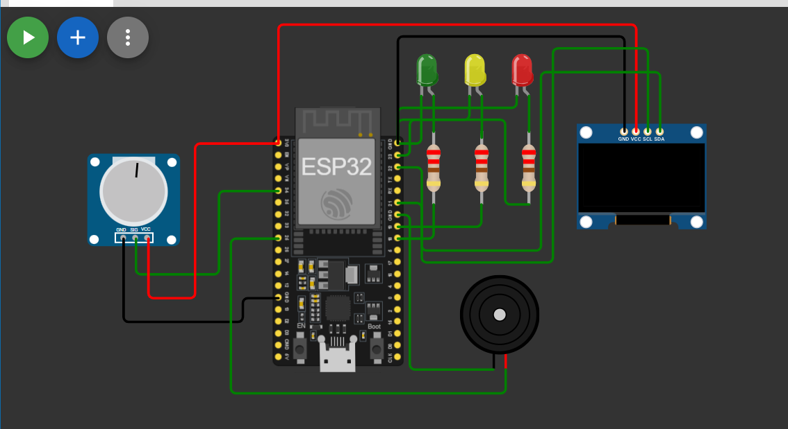

# GasGuard-IoT

**GasGuard — Intelligent Gas Leak Detection & Early Warning System**  
Team SOLVIX | CODIENYCH 1.0 | IoT Domain

An ESP32-based Wokwi prototype using a potentiometer to simulate gas sensor input. The ESP32 reads ADC values, classifies SAFE/WARNING/DANGER, drives LEDs and a buzzer, and displays the reading on an SSD1306 OLED.

## Circuit connections

| Component | ESP32 |
|---|---|
| Potentiometer SIG | GPIO34 |
| Potentiometer VCC / GND | 3V3 / GND |
| Green LED | GPIO18 |
| Yellow LED | GPIO19 |
| Red LED | GPIO23 |
| Buzzer | GPIO25 |
| OLED SDA / SCL | GPIO21 / GPIO22 |
| OLED VCC / GND | 3V3 / GND |

LEDs use current-limiting resistors.

## Demo logic

| ADC value | State | Output |
|---|---|---|
| < 1400 | SAFE | Green LED |
| 1400–2799 | WARNING | Yellow LED |
| >= 2800 | DANGER | Red LED + buzzer |

A rise of 600 ADC counts between successive samples also triggers WARNING unless the value is already DANGER.

## Run in Wokwi

Copy `sketch.ino` and `libraries.txt` into your working Wokwi project. Export your **actual** Wokwi `diagram.json` into this repository's root to make the complete circuit reproducible. Rotate the potentiometer to test all three levels.

## Important limitation

This is a **simulated sensor input**, not actual gas sensing. ADC percentages are not ppm, and thresholds are not calibrated gas safety limits.
